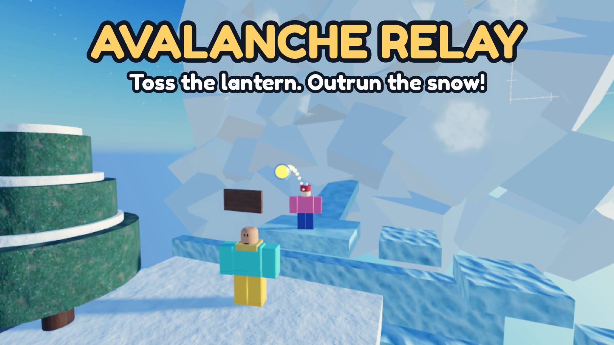

# 🏔️ Avalanche Relay

A co-op Roblox parkour race. Carry the glowing Summit Lantern down the mountain while an avalanche chases you. Whoever holds the lantern runs slower, so **toss it** to your squad across gaps.

**▶ Play:** https://www.roblox.com/games/76654692240887/Avalanche-Relay

## What's in it

- 🏮 Lantern tossing with a server-checked range and line of sight, and slow-mo on big tosses
- 🗻 A new mountain every day (a daily seed picks the segments, the same course for everyone)
- 👫 Squads of 1–4, plus Find Squad, Join invites and Run Again
- 🔥 Daily streaks, ❄️ Frost Badge rewards (flames, beanie, scarf, earmuffs)
- 🐧 Pip the penguin's first-run tips
- ☕ A cozy Cocoa Lodge lobby with hot cocoa you can hold
- 💾 DataStore saves with session locking, and a cosmetic-only game pass (Trailblazer Kit)

## Project layout

Everything lives in [`games/AvalancheRelay`](games/AvalancheRelay):

| Path | What |
| --- | --- |
| [`src/`](games/AvalancheRelay/src) | All Luau scripts, laid out like Studio (Rojo-compatible via `default.project.json`) |
| [`tools/BuildWorld.luau`](games/AvalancheRelay/tools/BuildWorld.luau) | Builds the lobby, the 9 course segments, the avalanche, lighting and audio in Studio |
| [`tools/SyncScripts.luau`](games/AvalancheRelay/tools/SyncScripts.luau) | Pulls `src/` into Studio from a local `python3 -m http.server 34999` |
| [`store/`](games/AvalancheRelay/store) | Icon and thumbnails |
| [`README.md`](games/AvalancheRelay/README.md) | Full game design: controls, remotes, saving and monetization |
| [`PUBLISHING.md`](games/AvalancheRelay/PUBLISHING.md) | Launch checklist and live status |

## Working on it

- **With Rojo:** run `rojo serve games/AvalancheRelay/default.project.json` and connect from the Rojo plugin in Studio.
- **Without Rojo:** run `python3 -m http.server 34999` inside `games/AvalancheRelay`, then run `tools/SyncScripts.luau` from Studio's command bar.
- To rebuild the world, run `tools/BuildWorld.luau` the same way.

## License

The code is released under the [MIT License](LICENSE), so you're free to use, change and share it. The Roblox game itself (its saves, game pass and earnings) stays with the creator's Roblox account.

Made with Roblox Studio and Claude.
